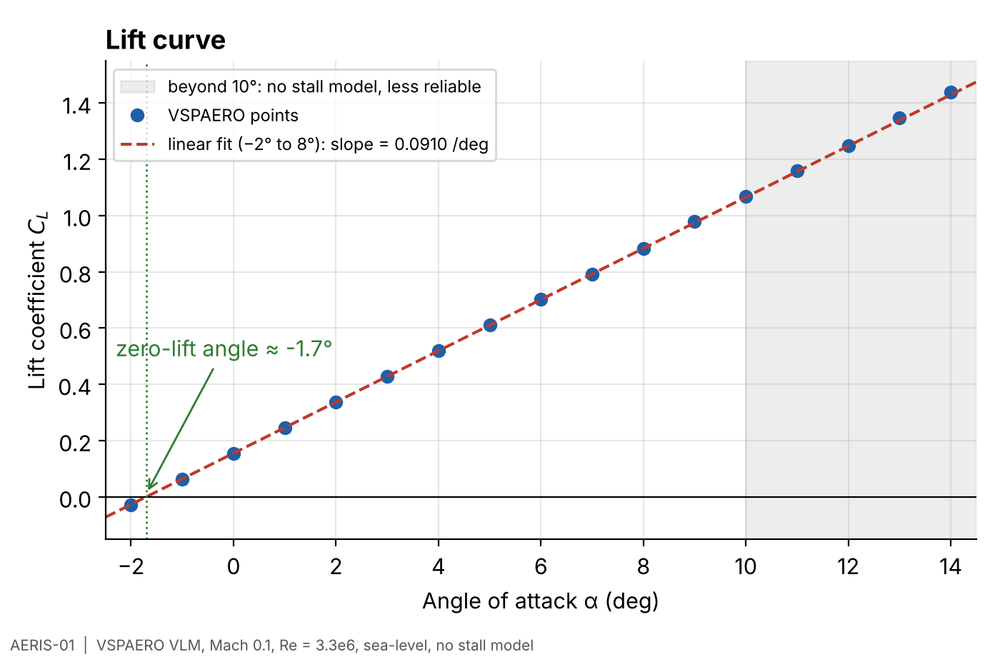
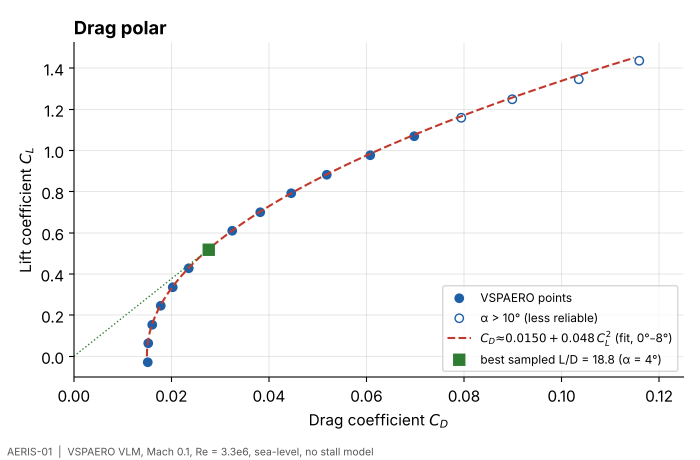
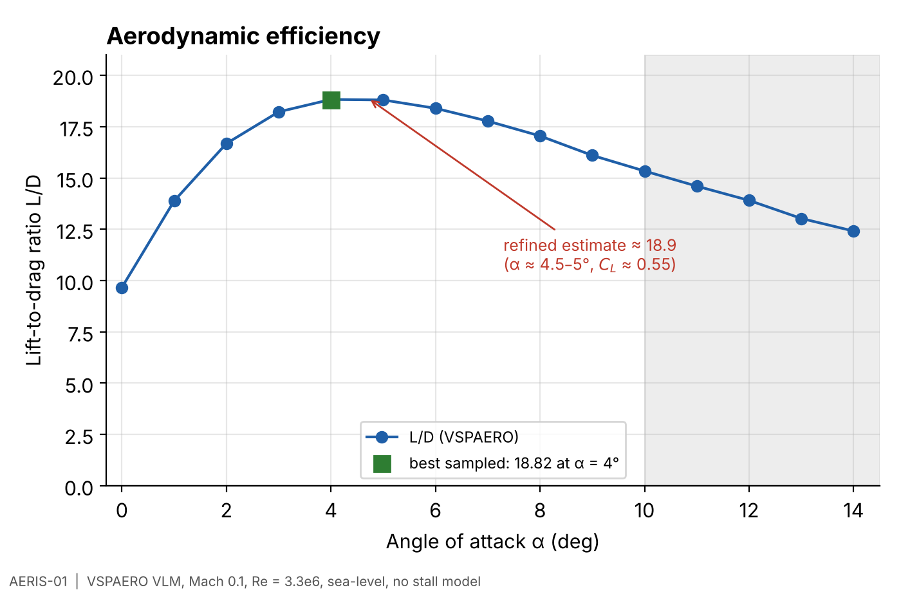

# AERIS-01 — Conceptual Two-Seat Trainer Aircraft

A personal aerodynamics project: I designed a small high-wing trainer aircraft in **OpenVSP** and analysed it with **VSPAERO** (vortex lattice method).

The aircraft is inspired by small training aircraft such as the Cessna 152, but it is not a copy of any real aircraft. **It is a concept study. It is not certified, validated or flight-ready.**

## The aircraft

| Parameter | Value |
|---|---|
| Configuration | High wing, conventional tail |
| Design mass (target) | 750 kg |
| Engine power (target) | 110 hp |
| Fuselage length | 7.35 m |
| Wingspan / wing area | 10.2 m / 14.535 m² |
| Aspect ratio / taper ratio | 7.16 / 0.5 |
| Wing dihedral / sweep | 3° / 0° |
| Wing airfoil | 2% camber, 12% thick (similar to NACA 2412) |
| Horizontal tail area | 2.30 m² |
| Vertical tail area | 1.05 m² |

Mass and power are design targets I chose, not calculated values. Landing gear is not modelled.

## Analysis setup

- Sea-level air, Mach 0.1 (about 34 m/s), Re = 3.3 million (reference chord 1.425 m)
- Angle of attack −2° to 14°, step 1°, no sideslip
- 10 wake iterations, symmetry on, stall model off
- Modelled in the solver: fuselage (thin surface), main wing, horizontal tail
- The vertical tail was **not** picked up by the solver.

## Main results

| Quantity | Value |
|---|---|
| Lift-curve slope (−2° to 8°) | 0.091 per degree (5.22 per radian) |
| Zero-lift angle | about −1.7° |
| Drag polar (fit, 0°–8°) | CD ≈ 0.0150 + 0.048 CL² |
| Best L/D (sampled) | 18.8 at α = 4° |
| Best L/D (smooth fit) | about 18.9 near α = 4.5°–5° |





## Limitations

- No stall model, so no maximum lift coefficient. I only trust the results up to about 10°.
- No landing gear, engine, cooling or struts, so real drag is higher and an L/D near 19 is optimistic.
- centre of gravity not defined; no stability or tail-size study.

## Next steps

Add the vertical tail to the analysis, estimate the centre of gravity and check tail size, test a finer mesh, and build a better drag estimate.

## Repository contents

```
AERIS-01/
├── model/AERIS-01_final.vsp3        OpenVSP model
├── results/                         plots and results table (CSV)
├── report/AERIS-01_Engineering_Report.docx
└── README.md
```

## How to repeat the analysis

1. Open `model/AERIS-01_final.vsp3` in OpenVSP 3.56 or newer.
2. In the VSPAERO window, check the settings above and press **Launch**.
3. Compare the polar with `results/AERIS-01_results_table.csv`.

## Tools

OpenVSP 3.56 and VSPAERO for the model. I used three AI tools during this project: ChatGPT, Claude, and DeepSeek. Each one helped me in a different part of the work.

At the beginning, I used GPT to learn the basic concepts and create a daily study plan. I started with the fundamentals of flight physics and aerodynamics, including lift, drag, thrust, weight, angle of attack, and stall. I also studied wing, fuselage, and tail design, the main parts of an airfoil, camber, thickness, chord, and how wing geometry works. Later, I learned about aspect ratio, taper ratio, sweep, dihedral, air density and its changes with altitude, and some basic takeoff and flight concepts.

I also combined GPT with YouTube tutorials to learn how to use OpenVSP, build the aircraft model, set up VSPAERO simulations, and extract and understand the results.

I then used Claude to turn the topics I had studied into short, organized study notes. These notes made it easier for me to review the concepts and keep track of what I had learned.

I used DeepSeek when I needed a different explanation of a topic or wanted to research technical information for the project. It was especially useful when I had questions that I could not fully understand from the first explanation.

In the later stages, I used Claude again to review calculations and compare some of my design parameters with real aircraft and engineering references. This gave me another way to check the consistency of my work and identify points that needed more attention.

All three tools supported me throughout the project, from the first learning steps to the analysis and review stages. In many ways, they acted like tutors, helping me understand new topics, work through problems, and improve my knowledge. However, I was still responsible for making the design decisions, building the model, running the simulations, and reviewing the results.

My approach to using AI was strongly influenced by the course **AI for Learning and Future Careers**, offered by the **University of Wollongong (UOW)**. The course helped me understand how to interact with AI more effectively, how to use it responsibly, and why it is important to understand its limitations. It also helped me become more aware of the rules and considerations involved in using AI for learning and research.

I would recommend this course to students, university learners, and educators who want to develop a better understanding of AI and learn how to use it effectively in their studies and work. 
